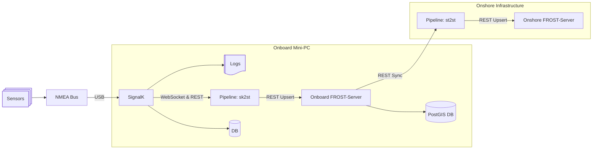

# SignalK to SensorThings Pipeline

The **SignalK to SensorThings** project is an asynchronous, modular data integration pipeline that converts sensor telemetry and metadata between [SignalK](https://signalk.org/) and [OGC SensorThings API (STA)](https://www.ogc.org/standard/sensorthings/) instances (such as [FROST-Server](https://fraunhoferiosb.github.io/FROST-Server/)).

The primary application on the USV-Gobelijn vehicle is to ingest NMEA 2000 and NMEA 0183 sensor observations from the onboard SignalK server, persist them into an onboard SensorThings database, and synchronize data to onshore SensorThings servers.

---

## System Overview

On the USV, a NMEA-to-USB converter connects the vehicle's NMEA bus to an Ubuntu mini-PC hosting Docker services, including SignalK and FROST-Server. More about the vessel hardware and container setup can be found in the [USV Docker Services Repository](https://git.vliz.be/mrc/e-equipment/e08-usv-gobelijn/usv-docker-services).



### Supported Pipelines

The service provides pluggable components managed by an asynchronous orchestrator:

1. **SignalK to SensorThings (`sk2st`)**:
   - Ingests vessel identity, lazy sensor / observed property metadata, and live delta streams from SignalK.
   - Transforms updates into OGC SensorThings entities (`Thing`, `Location`, `Sensor`, `ObservedProperty`, `Datastream`, `Observation`).
   - Persists observations into FROST-Server with dynamic datastream provisioning and geospatial `FeatureOfInterest` approximation.

2. **SensorThings to SensorThings (`st2st`)**:
   - Periodically polls an existing SensorThings server for new `HistoricalLocations` and `Observations`.
   - Replicates entities and telemetry to a secondary/onshore SensorThings server.

---

## Documentation

- **[Architecture & System Design](./docs/architecture.md)**: Detailed component design, class hierarchies, sequence diagrams, and domain entity mapping.
- **[Message Flow & Data Transformation](./docs/message_flow.md)**: End-to-end data lifecycle, protocol handshakes, and JSON payload examples.
- **[Configuration Guide](./config/README.md)**: Configuration schemas, parameters, and examples for all source connectors, convertors, and sinks.
- **[CI/CD Pipeline](./docs/GitlabCICD.md)**: Automated testing, static analysis, container builds, and GitLab CI setup.

---

## Development & Project Management (uv)

This project is managed with [`uv`](https://docs.astral.sh/uv/) and targets Python 3.14.

### Python Environment & Setup

Install and pin the target Python version:
```bash
uv python install 3.14
uv python pin 3.14
```

Synchronize dependencies and create the virtual environment:
```bash
uv sync
```

### Running Commands & Quality Tools

Run unit tests:
```bash
uv run pytest
```

Run linting and formatting checks:
```bash
uv run ruff check .
uv run ruff format --check .
```

Run static type analysis:
```bash
uv run pyright
```

---

## Running the Pipeline

### CLI Execution

Display help and available options:
```bash
uv run pipeline --help
```

Run the pipeline with the default configuration (`config.yaml`):
```bash
uv run pipeline
```

Run with a specific configuration profile:
```bash
# Run SignalK to SensorThings pipeline
uv run pipeline -c config/sk2st_config.yaml

# Run SensorThings to SensorThings replication pipeline
uv run pipeline -c config/st2st_config.yaml
```

### Docker Compose Local Environment

A local development stack containing SignalK, FROST-Server, PostGIS, and both pipeline workers is defined in `docker/compose.dev.yml`:

```bash
docker compose -f docker/compose.dev.yml up --build
```
