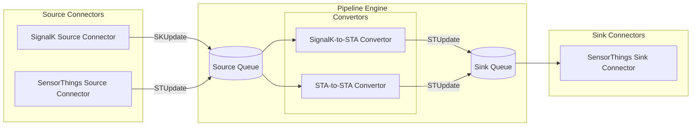
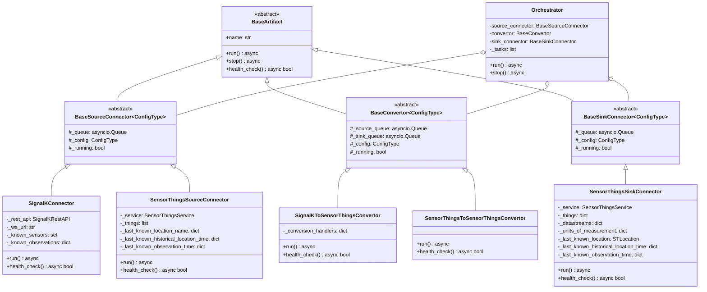
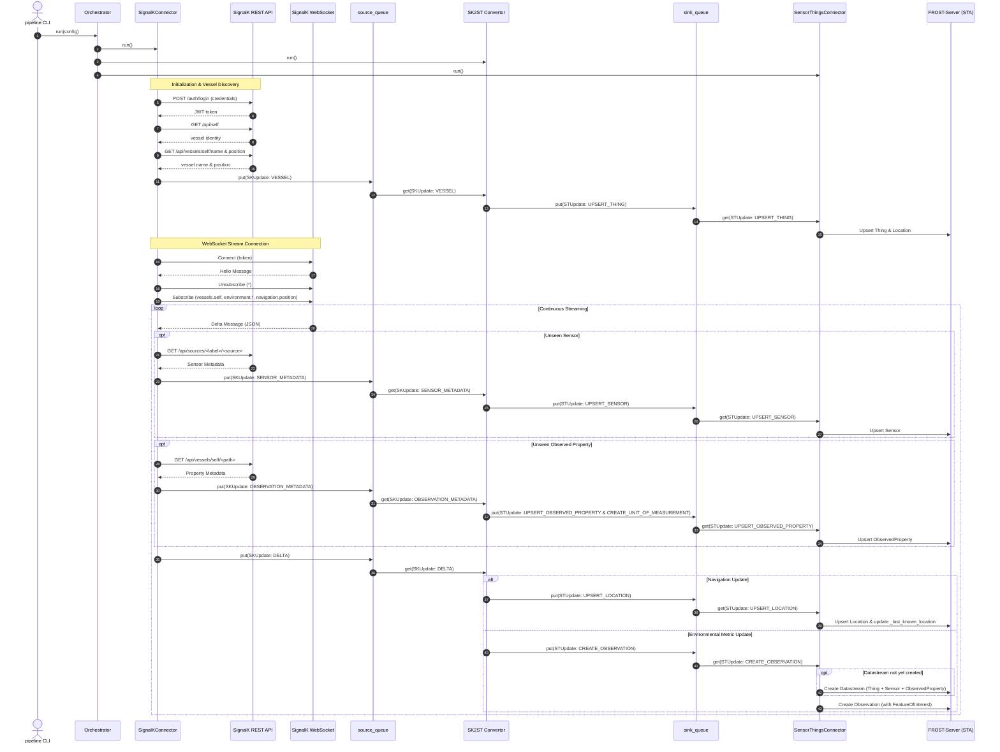
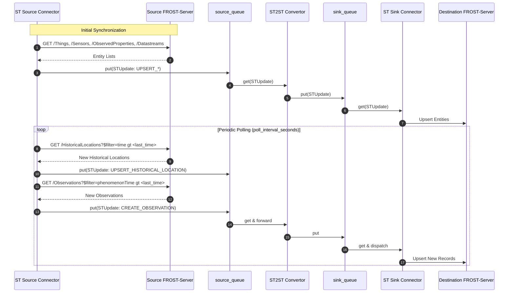
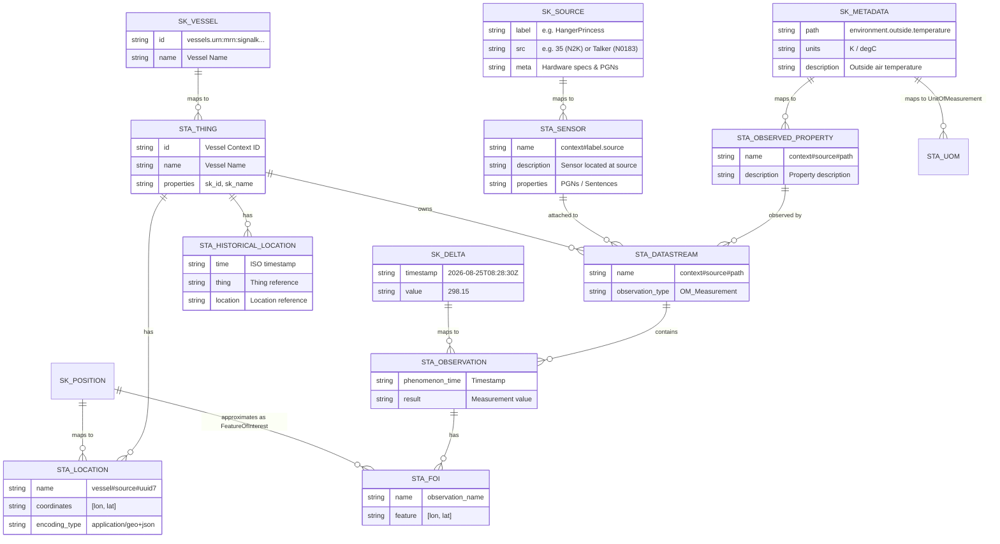

# Architecture & System Design

The **SignalK-to-SensorThings** service is an asynchronous, modular data integration pipeline that bridges sensor telemetry and OGC metadata. It supports ingesting from [SignalK](https://signalk.org/) servers or [OGC SensorThings API (STA)](https://www.ogc.org/standard/sensorthings/) instances (such as [FROST-Server](https://fraunhoferiosb.github.io/FROST-Server/)), converting data payloads, and dispatching to target SensorThings endpoints.

---

## 1. Architectural Overview

The application is structured as a decoupled **Producer-Consumer Pipeline** orchestrated by the `Orchestrator`. Communication across pipeline stages is mediated through asynchronous queues (`asyncio.Queue`), decoupling ingestion, transformation, and persistence workers.



### Key Architectural Characteristics
- **Asynchronous Concurrency:** Built on Python `asyncio` with isolated coroutines for source ingestion, transformation, and sink dispatching.
- **Dynamic Artifact Registry:** Plug-and-play architecture where sources, convertors, and sinks register via `@register_pipeline_artifact` and are resolved dynamically from configuration.
- **Strict Pydantic Validation:** SignalK and SensorThings domain models and updates are strongly typed and validated using Pydantic V2.
- **Lazy Metadata Discovery:** In the SignalK source, sensor and observed property metadata are fetched lazily from SignalK REST endpoints on first observation and cached.
- **Synchronized Deduplication & Ingestion Points:** The SensorThings sink and source connectors query synchronization points (latest `time` and `phenomenonTime`) to avoid duplicate or outdated insertions.
- **Dynamic Datastream Provisioning:** SensorThings `Datastream` entities are automatically provisioned on demand when new observation combinations are encountered.

---

## 2. Core Components



### 2.1. Orchestrator (`pipeline.orchestrator`)
The `Orchestrator` manages component lifecycles:
1. Loads the validated `Config` model.
2. Resolves registered components from `pipeline.registry` (`SOURCES`, `CONVERTORS`, `SINKS`).
3. Instantiates `source_queue` and `sink_queue` (`asyncio.Queue`).
4. Spawns tasks for the source connector, convertor, and sink connector with `asyncio.create_task`.
5. Monitors execution with `asyncio.gather` and coordinates clean shutdown upon cancellation or SIGINT.

### 2.2. SignalK Source Connector (`pipeline.source_connectors.signalk`)
Ingests data from SignalK using a hybrid REST + WebSocket strategy:
- **Authentication & Vessel Identity:**
  - Obtains a JWT bearer token via `/auth/login`.
  - Queries `/api/self`, `/api/vessels/self/name`, and `/api/vessels/self/navigation/position`.
  - Emits `SKUpdate(type=VESSEL, payload=SKVessel)` to `source_queue`.
- **WebSocket Streaming:**
  - Establishes connection to `/signalk/v1/stream?subscribe=none&token=...`.
  - Subscribes to configured paths (e.g. `environment.*`, `navigation.position`).
  - Filters messages exceeding `max_msg_age_minutes`.
- **Lazy Metadata Ingestion:**
  - For unseen sensor sources, queries `/api/sources/<label>/<src>` and emits `SKUpdate(type=SENSOR_METADATA, payload=SKSensor)`.
  - For unseen observation paths, queries `/api/vessels/self/<path>` and emits `SKUpdate(type=OBSERVATION_METADATA, payload=SKObservedProperty)`.
  - Emits `SKUpdate(type=DELTA, payload=SKDelta)`.

### 2.3. SensorThings Source Connector (`pipeline.source_connectors.sensorthings`)
Polls an existing SensorThings instance (e.g. onboard server) to replicate entities to another STA server (e.g. onshore):
- Syncs initial state: Things, HistoricalLocations, Locations, Sensors, ObservedProperties, and Observations.
- Periodically polls for updates every `poll_interval_seconds` using OData filter queries (`time gt ...`, `phenomenonTime gt ...`).
- Emits structured `STUpdate` commands into `source_queue`.

### 2.4. SignalK to SensorThings Convertor (`pipeline.convertors.signalk_to_sensorthings`)
Transforms `SKUpdate` domain objects into SensorThings `STUpdate` entities:
- **`SKUpdateType.VESSEL`** $\rightarrow$ `STUpdateType.UPSERT_THING` (`STThing` with embedded initial `STLocation`).
- **`SKUpdateType.SENSOR_METADATA`** $\rightarrow$ `STUpdateType.UPSERT_SENSOR` (`STSensor`).
- **`SKUpdateType.OBSERVATION_METADATA`** $\rightarrow$ `STUpdateType.UPSERT_OBSERVED_PROPERTY` (`STObservedProperty`) and `STUpdateType.CREATE_UNIT_OF_MEASUREMENT` (`STUnitOfMeasurement`).
- **`SKUpdateType.DELTA`:**
  - Navigation coordinates (`navigation.position`) $\rightarrow$ `STUpdateType.UPSERT_LOCATION` (`STLocation`).
  - Environmental observations (`environment.*`) $\rightarrow$ `STUpdateType.CREATE_OBSERVATION` (`STObservation`).

### 2.5. SensorThings to SensorThings Convertor (`pipeline.convertors.sensorthings_to_sensorthings`)
Acts as a high-performance asynchronous bridge passing `STUpdate` messages directly from `source_queue` to `sink_queue`.

### 2.6. SensorThings Sink Connector (`pipeline.sink_connectors.sensorthings`)
Synchronizes `STUpdate` commands with the destination SensorThings API:
- **`SensorThingsService` Helper:** Wraps `frost-sta-client` in `asyncio.to_thread` executions to prevent blocking the event loop.
- **Synchronization Point Initialization:** Queries destination STA for the latest `time` on HistoricalLocations and latest `phenomenonTime` on Observations to avoid re-inserting existing telemetry.
- **Entity Ingestion:**
  - `UPSERT_THING`: Upserts the vessel `Thing` and its location.
  - `UPSERT_LOCATION`: Upserts `Location` and updates `_last_known_location`.
  - `UPSERT_HISTORICAL_LOCATION`: Upserts `HistoricalLocation` linked to `Thing` and `Location`.
  - `UPSERT_SENSOR`: Upserts `Sensor`.
  - `UPSERT_OBSERVED_PROPERTY`: Upserts `ObservedProperty`.
  - `CREATE_UNIT_OF_MEASUREMENT`: Caches unit in memory for datastream creation.
  - `CREATE_OBSERVATION`: Ensures `Datastream` exists (provisioning on demand if absent), creates an approximated `FeatureOfInterest` from `_last_known_location`, and persists the `Observation`.

---

## 3. End-to-End Ingestion Sequences

### 3.1. SignalK to SensorThings Ingestion



### 3.2. SensorThings to SensorThings Ingestion



---

## 4. SignalK to SensorThings Domain Mapping



### Entity Mapping Details

| SignalK Concept | SensorThings Entity | Mapping Strategy & Notes |
| :--- | :--- | :--- |
| **Vessel (`self`)** | `Thing` | The SignalK vessel context ID becomes the `Thing` identifier. Properties contain `{"sk_id": vessel_id, "sk_name": vessel_name}`. |
| **Navigation (`navigation.position`)** | `Location` | GPS coordinates create an `STLocation` named `<vessel_id>#<source>#<uuid7>`. Stored in `_last_known_location` for subsequent observation geospatial references. |
| **Source (`sources/<label>/<src>`)** | `Sensor` | Unique name generated as `<context>#<label>.<src>` (or `<context>#<label>.<talker>` for NMEA 0183). Contains hardware PGNs / sentences in `properties`. |
| **Path Metadata (`<path>/meta`)** | `ObservedProperty` & `UnitOfMeasurement` | Name generated as `<context>#<source>#<path>`. Units stored in `UnitOfMeasurement`, and metadata properties stored in `ObservedProperty.properties`. |
| **Delta Value (`updates.values`)** | `Observation` & `Datastream` | Ingested into a `Datastream` (`<context>#<source>#<path>`). Creates an `Observation` with `phenomenon_time` matching the SignalK timestamp. |

---

## 5. Configuration & Deployment

Configurations are written in YAML or JSON and loaded via `pipeline.models.config.Config`:

### SignalK to SensorThings (`config/sk2st_config.yaml`)
```yaml
log_level: info

source:
  signalk:
    username: readonly
    password: signalk_ro
    subscriptions:
      context: vessels.self
      subscriptions:
        - path: environment.*
          period: 1000
          policy: fixed
          format: delta
        - path: navigation.position
          period: 1000
          policy: fixed
          format: delta

convertor:
  signalk_sensorthings: {}

sink:
  sensorthings:
    host: web
```

### SensorThings to SensorThings (`config/st2st_config.yaml`)
```yaml
log_level: info

source:
  sensorthings:
    host: web

convertor:
  sensorthings_sensorthings: {}

sink:
  sensorthings:
    host: web2
```

### CLI Execution
The application is invoked via the CLI entrypoint registered in `pyproject.toml`:

```bash
# Run default configuration (config.yaml)
uv run pipeline

# Run specific configuration file
uv run pipeline -c config/sk2st_config.yaml
uv run pipeline --config-path config/st2st_config.yaml
```

---

## 6. Project Directory Reference

```
src/pipeline/
├── __init__.py                  # CLI entrypoint, logging setup, run_pipeline()
├── orchestrator.py              # Orchestrator lifecycle & queue management
├── registry.py                  # Dynamic artifact registry (@register_pipeline_artifact)
├── error.py                     # Custom exception hierarchy
├── models/                      # Pydantic data models
│   ├── __init__.py              # Exported domain models & enums
│   ├── artifacts.py             # BaseArtifact, BaseSourceConnector, BaseConvertor, BaseSinkConnector
│   ├── config.py                # Config schema & loader
│   ├── convertor.py             # Convertor configuration models
│   ├── sensorthings.py          # SensorThings internal entities & update commands
│   └── signalk.py               # SignalK delta, meta, position & update models
├── convertors/                  # Convertor implementations
│   ├── __init__.py
│   ├── sensorthings_to_sensorthings.py # SensorThings-to-SensorThings convertor
│   └── signalk_to_sensorthings.py      # SignalK-to-SensorThings convertor
├── source_connectors/           # Source connector implementations
│   ├── __init__.py
│   ├── sensorthings.py          # SensorThings REST polling source connector
│   └── signalk.py               # SignalK WebSocket & REST streaming connector
├── sink_connectors/             # Sink connector implementations
│   ├── __init__.py
│   └── sensorthings.py          # SensorThings sink connector
└── utils/                       # Shared utility services & helpers
    ├── __init__.py
    ├── decorators.py            # Utility decorators (classproperty)
    ├── sensorthings_service.py  # FROST-Server client wrapper
    └── signalk_rest_api.py      # SignalK REST API HTTP client
```
