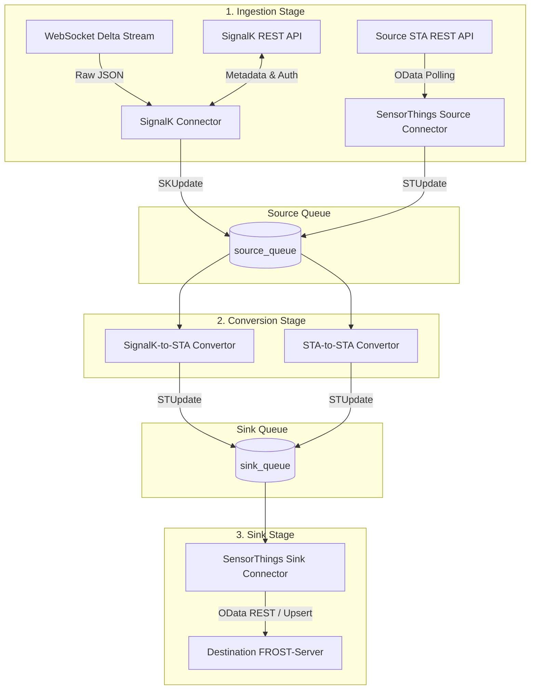

# Message Flow & Data Transformation

This document details the end-to-end data flow, message lifecycle, protocol interactions, and payload transformations across the pipeline.

---

## 1. Pipeline Message Flow Overview

The pipeline uses asynchronous queues (`asyncio.Queue`) to decouple ingestion from transformation and persistence:



---

## 2. SignalK to SensorThings Message Flow (`sk2st`)

### Step 1: Vessel Discovery & Initialization
1. **REST Authentication:** `SignalKConnector` sends credentials (`username`, `password`) to `{protocol_rest}://{host}:{port}/{server_name}/v1/auth/login` to obtain a JWT bearer token.
2. **Vessel Identity:** Queries `/api/self` to resolve the vessel context identifier (e.g. `vessels.urn:mrn:signalk:uuid:97d075e2-e56b-4a44-842f-2718aa07c409`).
3. **Vessel Attributes & Initial Position:** Queries `/api/vessels/self/name` and `/api/vessels/self/navigation/position`.
4. **Queue Emission:** Emits `SKUpdate(type=SKUpdateType.VESSEL, payload=SKVessel)` into `source_queue`.
5. **Transformation:** `SignalKToSensorThingsConvertor` maps `SKVessel` to `STUpdate(type=STUpdateType.UPSERT_THING, payload=STThing)` containing an initial `STLocation`.
6. **Persistence:** `SensorThingsConnector` upserts the `Thing` and `Location` in FROST-Server and stores the coordinate in `_last_known_location`.

### Step 2: WebSocket Streaming & Subscription
1. Connects to `{ws_base_url}/stream?subscribe=none&token={token}`.
2. Receives and validates the server `SKHello` message.
3. Unsubscribes from default channels:
   ```json
   {"context": "*", "unsubscribe": [{"path": "*"}]}
   ```
4. Issues granular subscriptions from configuration (e.g., `environment.*`, `navigation.position`):
   ```json
   {
     "context": "vessels.self",
     "subscribe": [
       {"path": "environment.*", "period": 1000, "policy": "fixed", "format": "delta"},
       {"path": "navigation.position", "period": 1000, "policy": "fixed", "format": "delta"}
     ]
   }
   ```

### Step 3: Delta Processing & Lazy Metadata Discovery
When a delta message arrives via WebSocket:
1. **Age Filtering:** Compares message timestamp against `max_msg_age_minutes`. Stale updates are dropped.
2. **Lazy Sensor Discovery:**
   - If an update references an unseen sensor source (`<label>.<src>` for NMEA 2000 or `<label>.<talker>` for NMEA 0183), the connector requests metadata via REST:
     `GET /api/sources/{label}/{source}`
   - Emits `SKUpdate(type=SKUpdateType.SENSOR_METADATA, payload=SKSensor)`.
   - The convertor creates `STUpdate(type=STUpdateType.UPSERT_SENSOR, payload=STSensor)`.
   - The sink connector upserts the `Sensor` in FROST-Server.
3. **Lazy Observed Property Discovery:**
   - If an update contains an unseen observation path (e.g., `environment.outside.temperature`), the connector requests metadata via REST:
     `GET /api/vessels/self/{observation_path}`
   - Emits `SKUpdate(type=SKUpdateType.OBSERVATION_METADATA, payload=SKObservedProperty)`.
   - The convertor creates `STUpdate(type=STUpdateType.UPSERT_OBSERVED_PROPERTY, payload=STObservedProperty)` and `STUpdate(type=STUpdateType.CREATE_UNIT_OF_MEASUREMENT, payload=STUnitOfMeasurement)`.
   - The sink connector upserts the `ObservedProperty` and caches the unit of measurement.
4. **Delta Message Ingestion:**
   - Emits `SKUpdate(type=SKUpdateType.DELTA, payload=SKDelta)`.
   - **Navigation Updates (`navigation.position`):** Converted to `STUpdate(type=STUpdateType.UPSERT_LOCATION, payload=STLocation)`. The sink upserts the `Location` in FROST-Server and updates `_last_known_location`.
   - **Observation Updates (`environment.*`):** Converted to `STUpdate(type=STUpdateType.CREATE_OBSERVATION, payload=STObservation)`.

### Step 4: SensorThings Persistence & Dynamic Provisioning
1. **Datastream Provisioning:** If a `Datastream` does not exist for the combination of `(Thing, Sensor, ObservedProperty)`, the sink connector dynamically creates and upserts a `FrostDatastream`.
2. **FeatureOfInterest Attachment:** The sink attaches an approximated `FeatureOfInterest` constructed from `_last_known_location` (or uses an explicit FOI if supplied).
3. **Observation Persistence:** The sink calls `_service.create_observation()` to store the measurement in FROST-Server.

---

## 3. SensorThings to SensorThings Message Flow (`st2st`)

The `st2st` configuration enables synchronization across SensorThings servers (e.g. replicating edge data to onshore servers):

1. **Initial Full State Sync:**
   - Queries source STA for `Things`, `Locations`, `HistoricalLocations`, `Sensors`, `ObservedProperties`, `Datastreams`, and `Observations`.
   - Emits corresponding `STUpdate` commands.
2. **Continuous Polling Loop:**
   - Every `poll_interval_seconds`, executes OData filter queries:
     - `GET /HistoricalLocations?$filter=time gt <last_known_time>&$orderby=time asc`
     - `GET /Observations?$filter=phenomenonTime gt <last_known_time>&$orderby=phenomenonTime asc`
   - Emits `UPSERT_HISTORICAL_LOCATION` and `CREATE_OBSERVATION` updates.
3. **Direct Pass-Through & Ingestion:**
   - `SensorThingsToSensorThingsConvertor` transfers `STUpdate` instances directly to `sink_queue`.
   - `SensorThingsConnector` sink persists the entities into the destination STA server.

---

## 4. Payload Examples

### 4.1. SignalK Inbound Payloads

#### Server Hello Message
```json
{
  "name": "signalk-server",
  "version": "2.0.0",
  "self": "vessels.urn:mrn:signalk:uuid:97d075e2-e56b-4a44-842f-2718aa07c409",
  "roles": ["master", "main"],
  "timestamp": "2026-08-25T08:28:30.000Z"
}
```

#### Sensor Source REST Metadata (`/api/sources/HangerPrincess/35`)
```json
{
  "pgns": {
    "130310": "2026-08-25T08:28:30.000Z",
    "130311": "2026-08-25T08:28:30.000Z"
  },
  "manufacturerCode": "Airmar",
  "modelId": "WX Series WeatherStation Sensor",
  "modelSerialCode": "60831339",
  "src": "35"
}
```

#### Observed Property REST Metadata (`/api/vessels/self/environment/outside/temperature`)
```json
{
  "description": "Outside air temperature.",
  "units": "K",
  "displayUnits": {
    "category": "temperature",
    "targetUnit": "C",
    "formula": "value - 273.15",
    "inverseFormula": "value + 273.15",
    "symbol": "°C",
    "displayFormat": "0.0"
  }
}
```

#### SignalK Delta Stream Message
```json
{
  "context": "vessels.urn:mrn:signalk:uuid:97d075e2-e56b-4a44-842f-2718aa07c409",
  "updates": [
    {
      "source": {
        "label": "HangerPrincess",
        "type": "NMEA2000",
        "pgn": 130311,
        "src": "35",
        "canName": "c0a0b40110e15140",
        "deviceInstance": 1
      },
      "$source": "HangerPrincess.c0a0b40110e15140",
      "timestamp": "2026-08-25T08:28:30.227Z",
      "values": [
        {
          "path": "environment.outside.temperature",
          "value": 298.15
        }
      ]
    }
  ]
}
```

---

### 4.2. SensorThings Outbound Entities (FROST-Server)

#### Thing
```json
{
  "name": "vessels.urn:mrn:signalk:uuid:97d075e2-e56b-4a44-842f-2718aa07c409",
  "description": "<Description was not set>",
  "properties": {
    "sk_id": "vessels.urn:mrn:signalk:uuid:97d075e2-e56b-4a44-842f-2718aa07c409",
    "sk_name": "USV-Gobelijn"
  }
}
```

#### Sensor
```json
{
  "name": "vessels.urn:mrn:signalk:uuid:97d075e2-e56b-4a44-842f-2718aa07c409#HangerPrincess.35",
  "description": "Sensor located at HangerPrincess.35",
  "encodingType": "text/html",
  "metadata": "<Metadata not set>",
  "properties": {
    "manufacturerCode": "Airmar",
    "modelId": "WX Series WeatherStation Sensor",
    "src": "35"
  }
}
```

#### ObservedProperty
```json
{
  "name": "vessels.urn:mrn:signalk:uuid:97d075e2-e56b-4a44-842f-2718aa07c409#HangerPrincess.35#environment.outside.temperature",
  "description": "Outside air temperature.",
  "definition": "<Definition not set>",
  "properties": {
    "units": "K",
    "displayUnits": {
      "symbol": "°C",
      "targetUnit": "C"
    }
  }
}
```

#### Datastream
```json
{
  "name": "vessels.urn:mrn:signalk:uuid:97d075e2-e56b-4a44-842f-2718aa07c409#HangerPrincess.35#environment.outside.temperature",
  "description": "Datastream created from sensor ... observing ... while mounted on ...",
  "observationType": "http://www.opengis.net/def/observationType/OGC-OM/2.0/OM_Measurement",
  "unitOfMeasurement": {
    "name": "vessels.urn:mrn:signalk:uuid:97d075e2-e56b-4a44-842f-2718aa07c409#HangerPrincess.35#environment.outside.temperature",
    "symbol": "K",
    "definition": "<Definition not set>"
  }
}
```

#### Observation
```json
{
  "phenomenonTime": "2026-08-25T08:28:30.227000+00:00",
  "result": 298.15,
  "resultTime": "2026-08-25T08:28:30.227000+00:00",
  "FeatureOfInterest": {
    "name": "vessels.urn:mrn:signalk:uuid:97d075e2-e56b-4a44-842f-2718aa07c409#HangerPrincess.35#environment.outside.temperature",
    "description": "Position where observation is made (approximated).",
    "encodingType": "application/geo+json",
    "feature": {
      "type": "Point",
      "coordinates": [2.928935, 51.2357333]
    }
  }
}
```
